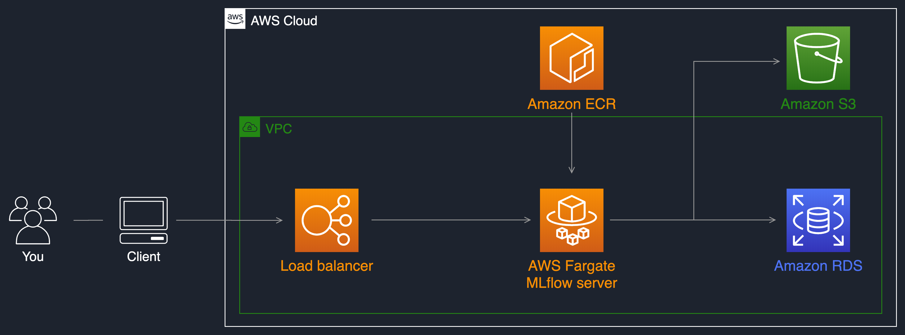
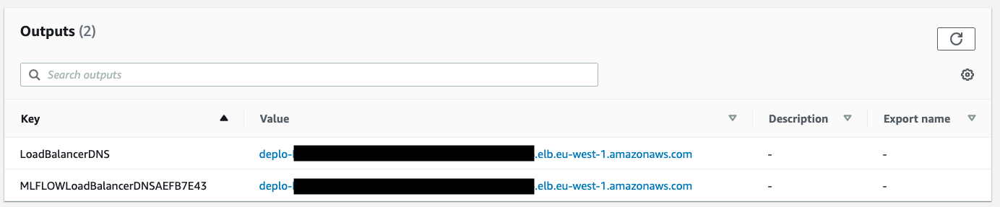
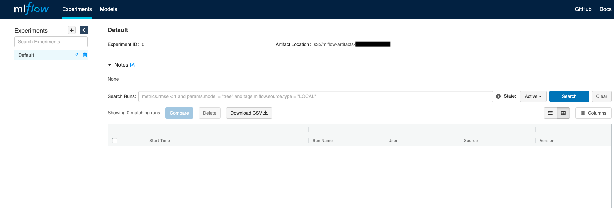
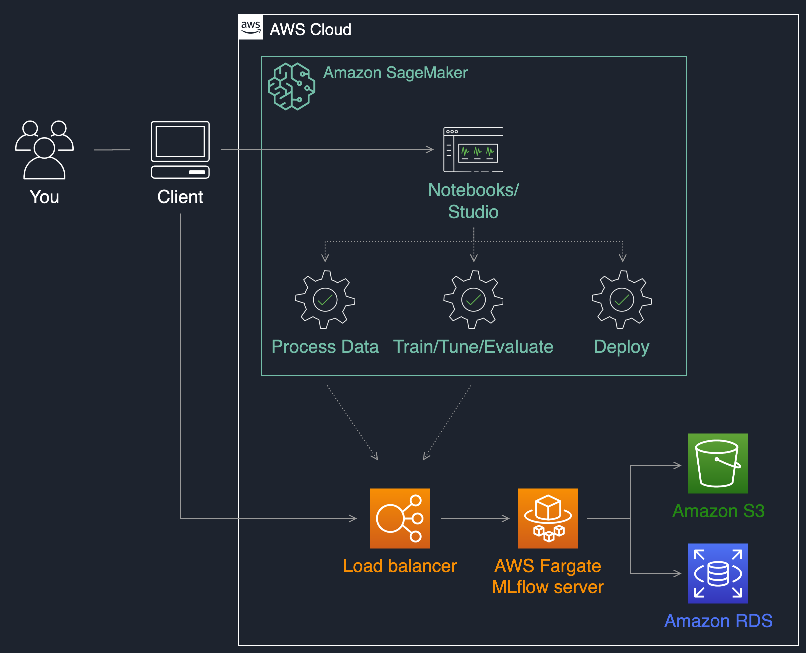

## Manage your machine learning lifecycle with MLflow and Amazon SageMaker

### Overview

In this repository we show how to deploy MLflow on AWS Fargate and how to use it during your ML project
with [Amazon SageMaker](https://aws.amazon.com/sagemaker). You will use Amazon SageMaker to develop, train, tune and
deploy a Scikit-Learn based ML model (Random Forest) and track experiment runs and models with MLflow.

This implementation shows how to do the following:

* Host a serverless MLflow server on AWS Fargate with S3 as artifact store and RDS and backend stores
* Track experiment runs running on SageMaker with MLflow
* Register models trained in SageMaker in the MLflow model registry
* Deploy an MLflow model into a SageMaker endpoint

### MLflow tracking server
You can set a central MLflow tracking server during your ML project. By using this remote MLflow server, data scientists
will be able to manage experiments and models in a collaborative manner.
An MLflow tracking server also has two components for storage: a ```backend store``` and an ```artifact store```. This
implementation uses an Amazon S3 bucket as artifact store and an Amazon RDS instance for MySQL as backend store.



### Prerequisites

We will use [the AWS CDK](https://cdkworkshop.com/) to deploy the MLflow server.

To go through this example, make sure you have the following:
* An AWS account where the service will be deployed
* [AWS CDK installed and configured](https://docs.aws.amazon.com/cdk/latest/guide/getting_started.html). Make sure to have the credentials and permissions to deploy the stack into your account
* [Docker](https://www.docker.com) to build and push the MLflow container image to ECR
* This [Github repository](https://github.com/aws-samples/amazon-sagemaker-mlflow-fargate) cloned into your environment to follow the steps

### Deploying the stack

You can view the CDK stack details in [app.py](https://github.com/aws-samples/amazon-sagemaker-mlflow-fargate/blob/main/app.py).
Run these commands in [AWS CloudShell](https://console.aws.amazon.com/cloudshell) (tested Oct 2026 with
`aws-cdk-lib 2.274.0`):

```bash
git clone https://github.com/03sarath/amazon-sagemaker-mlflow-fargate.git
cd amazon-sagemaker-mlflow-fargate          # or: git pull, if already cloned

# CloudShell home is world-writable (0777); jsii refuses to run until it is fixed
chmod 755 ~

# Global npm install needs sudo in CloudShell
sudo npm install -g aws-cdk@latest

python3 -m venv .venv
source .venv/bin/activate
pip3 install -r requirements.txt

ACCOUNT_ID=$(aws sts get-caller-identity --query Account --output text)
AWS_REGION=$(aws configure get region)
cdk bootstrap aws://${ACCOUNT_ID}/${AWS_REGION}   # once per account/region
cdk deploy --parameters ProjectName=mlflow --require-approval never
```

`cdk deploy` builds the MLflow server image from `container/Dockerfile`, pushes it to ECR and deploys the stack.
Copy the **`LoadBalancerDNS`** value from the stack outputs: it is your MLflow tracking URI.
Re-run `cdk deploy` whenever the MLflow version in `container/Dockerfile` changes; RDS and S3 are kept, so runs and
models are not lost.

Troubleshooting:

| Error | Fix |
|---|---|
| `Cannot use the jsii package cache ... (mode 0777)` | `chmod 755 ~` (or `export JSII_RUNTIME_PACKAGE_CACHE=disabled`) |
| `npm error code EACCES` on `npm install -g` | use `sudo npm install -g aws-cdk@latest` |
| `Node 20 has reached end-of-life` warning | only a warning; silence with `export JSII_SILENCE_WARNING_DEPRECATED_NODE_VERSION=1` |

The stack will take a few minutes to launch the MLflow server on AWS Fargate, with an S3 bucket and a MySQL database on
RDS. You can then use the load balancer URI present in the stack outputs to access the MLflow UI:



**N.B:** In this illustrative example stack, the load balancer is launched on a public subnet and is internet facing.
For security purposes, you may want to provision an internal load balancer in your VPC private subnets where there is no
direct connectivity from the outside world. Here is a blog post explaining how to achieve
this: [Access Private applications on AWS Fargate using Amazon API Gateway PrivateLink](https://aws.amazon.com/blogs/compute/access-private-applications-on-aws-fargate-using-amazon-api-gateway-privatelink/)

### Managing an ML lifecycle with Amazon SageMaker and MLflow

You now have a remote MLflow tracking server running accessible through
a [REST API](https://mlflow.org/docs/latest/rest-api.html#rest-api) via
the [load balancer uri](https://mlflow.org/docs/latest/quickstart.html#quickstart-logging-to-remote-server). 
You can use the MLflow Tracking API to log parameters, metrics, and models when running your machine learning project with Amazon
SageMaker. For this you will need install the MLflow library when running your code on Amazon SageMaker and set the
remote tracking uri to be your load balancer address.

The following python API command allows you to point your code executing on SageMaker to your MLflow remote server:

```
import mlflow
mlflow.set_tracking_uri('<YOUR LOAD BALANCER URI>')
```

Connect to your notebook instance and set the remote tracking URI.


### Running an example lab

This describes how to develop, train, tune and deploy a Random Forest model using Scikit-learn with
the [SageMaker Python SDK v3](https://sagemaker.readthedocs.io/en/stable/) (`ModelTrainer`, `HyperparameterTuner`). We use
the [California Housing dataset](https://scikit-learn.org/stable/modules/generated/sklearn.datasets.fetch_california_housing.html)
from Scikit-Learn and log our machine learning runs into MLflow 3.

Versions: MLflow `3.17.2` (server, training job and notebooks must match), SageMaker SDK `3.x`,
SageMaker Scikit-learn container `1.4-2`.

On your SageMaker notebook instance:

1. Clone (or `git pull`) this repository.
2. In each notebook, replace `<YOUR-LOAD-BALANCER-DNS>` with the `LoadBalancerDNS` stack output.
3. Run the notebooks in order, restarting the kernel after the first install cell of each:

* lab/1_track_experiments.ipynb - train on SageMaker, log params, metrics, dataset and model to MLflow
* lab/2_track_experiments_hpo.ipynb - tune with SageMaker HPO, compare trials, register the best model as `@champion`
* lab/3_deploy_model.ipynb - deploy `models:/california-housing@champion` to a SageMaker endpoint
  (the first `mlflow sagemaker build-and-push-container` takes 10-20 minutes; delete the endpoint at the end to stop costs)

#### Register the best model and set the `champion` alias from the MLflow UI

Lab 2 does this in code. To do the same in the MLflow UI (open the `LoadBalancerDNS` URL in your browser):

1. **Find the best run** - **Experiments** > `california-housing-hpo`. In the runs table, click **Columns** and add
   `root_mean_squared_error`, then click that column header to sort ascending. The top run is the best (lowest RMSE).
   Optional: select several runs and click **Compare** to see the parallel-coordinates chart.
2. **Register its model** - open the best run. In MLflow 3 the model is a *logged model*: click it in the run's
   **Logged models** section (or the experiment's **Models** tab), then click **Register model**.
   On older MLflow UIs: **Artifacts** > select the `model` folder > **Register Model**.
3. **Choose the registered model** - in the pop-up pick `california-housing` (or **Create New Model** and type
   `california-housing` the first time), then **Register**. MLflow creates a new version (v1, v2, ...).
4. **Set the alias** - go to **Models** > `california-housing`. In the versions table, click **Add** (or the pencil
   icon) in the **Aliases** column of the new version, type `champion`, and **Save**. An alias points to only one
   version, so adding it here moves it away from the previous version.
5. **Use it** - Lab 3 deploys `models:/california-housing@champion`; after moving the alias, re-run the
   `update_deployment` cell to roll the endpoint to the new version.

Model stages (Staging/Production) are deprecated in MLflow 3; use aliases instead.

### Current limitation on user access control

The [open source version](https://github.com/mlflow/mlflow) of MLflow does not currently provide user access control
features in case you have multiple tenants on your MLflow server. This means any user having access to the MLflow server
can modify experiments, model versions, and stages. This can be a challenge for enterprises in regulated industries that
need to keep strong model governance for audit purposes.

### Security

See [CONTRIBUTING](CONTRIBUTING.md#security-issue-notifications) for more information.

### License

This library is licensed under the MIT-0 License. See the LICENSE file.

